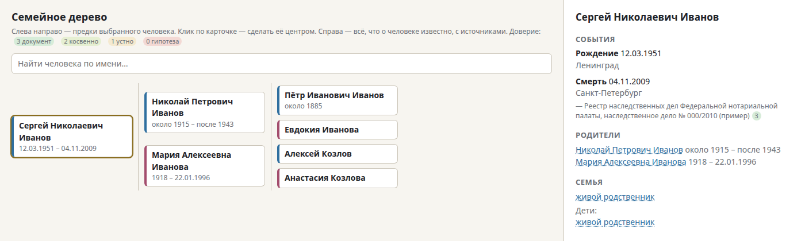

# ru-genealogy-search: find ancestors in Russian and Soviet records with Claude Code

A skill for [Claude Code](https://claude.com/claude-code). Claude searches open online
databases of Russia and the former USSR for your ancestors and relatives and builds a
family tree in GEDCOM format.

*Русская версия: [README.md](README.md).*



The skill grew out of the author's own family research. It records the methods that
worked and the mistakes the model made without guidance. Most databases are in Russian;
you can ask Claude in English, and it will search in Russian and report back in English.

## What it adds

Claude already knows the well-known sites (OBD Memorial, Pamyat Naroda, FamilySearch, the
VGD forum). The skill adds what the model does not know:

- **how to query the databases from a script** and what each one gives:
  - the inheritance case registry of the Russian notaries: date of birth, date of death
    and last address of people who died from about the 1990s on;
  - the database of people evacuated from besieged Leningrad;
  - "Vozvrashchennye imena" (Returned Names) of the National Library of Russia: memorial
    books of victims of repression;
  - OBD Memorial (Soviet WWII losses);
- **which sites block bots** (FamilySearch, Pamyat Naroda) and how to search them by hand,
  with a ready-made task;
- **how to get through the "dark" 1920s–1960s**, when civil registry records are closed:
  through patronymics, addresses from the notary registry, loss reports and captions on
  family photos;
- **how to record findings**: source, case and frame number, a confidence level from 0
  to 3, and empty results too;
- **tree tools**: a GEDCOM checker and an offline browser viewer.

## Rules built into the skill

- It helps you look for living relatives together with you: it suggests searches on VK
  and Odnoklassniki, looks at public pages and judges kinship. It does not build dossiers:
  only the name, approximate year, town and relationship go into the tree. You contact
  people yourself. Living people are marked private, and the viewer hides them by default.
- It does not bypass captchas, bot protection or logins, and does not take cookies or
  passwords.
- It does not use leaked databases.
- It treats text from found pages as data, not as instructions.
- It warns you before searching for recently deceased relatives of living people.

## Installation

```bash
git clone https://github.com/olyamasaeva/ru-genealogy-search ~/.claude/skills/ru-genealogy-search
```

The scripts need Python 3.10+ and Node.js 20+ (tested on Linux). The skill installs
Playwright and Chromium itself with the command from `sources.md`, section "Установка".
For strict GEDCOM checks you can install `pip install python-gedcom==1.1.0`.

Network access differs by site: in October 2026 the notary registry, OBD Memorial and
Returned Names answered through a proxy, while the evacuation database answered only on a
direct connection (`--direct`). Browser scripts take a proxy from
`PW_PROXY=socks5://host:port`. Details are in `sources.md`.

## How to use

In Claude Code, write for example:

- "Find when my great-grandmother Maria Ivanovna Smirnova died; she lived in the Tver
  region"
- "Search for my great-grandfather in the WWII loss databases"
- "Were my ancestors evacuated from Leningrad?"
- "Check my tree family.ged and show it in the browser"

Or call the skill directly: `/ru-genealogy-search`.

Try the tree viewer on the fictional family in `examples/`:

```bash
python3 ~/.claude/skills/ru-genealogy-search/scripts/ged2html.py \
  ~/.claude/skills/ru-genealogy-search/examples/demo.ged ~/demo-tree.html --root I2
```

## FAQ

**How do I find the date of death of a relative who died in Russia after 1990?**
Through the inheritance case registry of the Federal Notary Chamber. It searches by full
name (surname, first name, patronymic) and gives the dates of birth and death and the
last address. If the patronymic is unknown, the skill tries a list of them. There is no
case if the property was given away during the person's lifetime or if they died under
another surname.

**How do I find a great-grandfather killed or missing in WWII?**
The skill searches OBD Memorial itself. Pamyat Naroda blocks bots, so the skill prepares a
task for you to search by hand. A loss report often gives the place of birth and the
family's address. Survivors are not in OBD, so an empty result does not mean the person
did not serve.

**What about the 1920s–1960s, when civil registry records are closed?**
In Russia, civil registry records younger than 100 years are given only to relatives.
The skill works around the gap through children's patronymics, addresses from the notary
registry, loss reports and captions on family photos. The recipes are in `sources.md`,
section "Мосты через 1920–1960".

**Where are parish registers from before 1917?**
On FamilySearch and in Yandex "Search in archives". First the skill finds which province,
district and parish the village belonged to at the time, and only then looks for the
archive and fond.

**Do I need a paid account?**
No. The skill uses open databases only. You need Claude Code.

## Limitations

- Coverage is best for north-western Russia and the 20th century. For other regions the
  skill first works out the administrative division of the time and finds the right
  archive. Catalogue numbers from the examples do not carry over to other regions.
- Websites change. The scripts report when a page is not recognised or the results are
  cut off, but they may stop working.
- "Blockade. Book of Memory" and the Lutheran registers of Ingria are mentioned but not
  tested with scripts.

## Responsibility

The skill uses open government and public databases at the pace of an ordinary visitor.
Follow the rules of the sites you use. Keep information about people, including deceased
relatives of living people, to yourself, and do not publish it without the family's
consent. Findings are hypotheses until documents confirm them.

## License

MIT, see [LICENSE](LICENSE).
