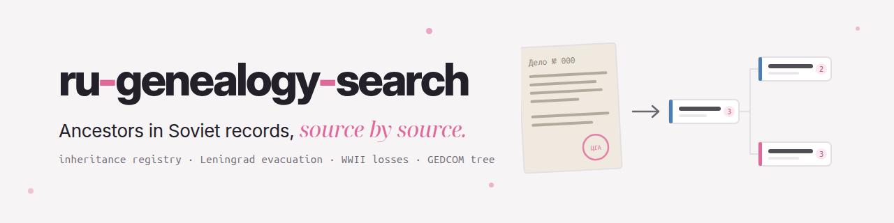
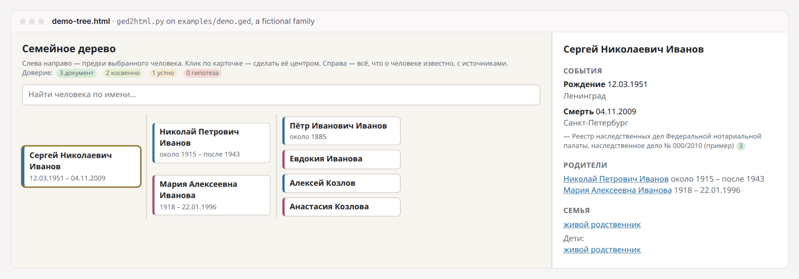
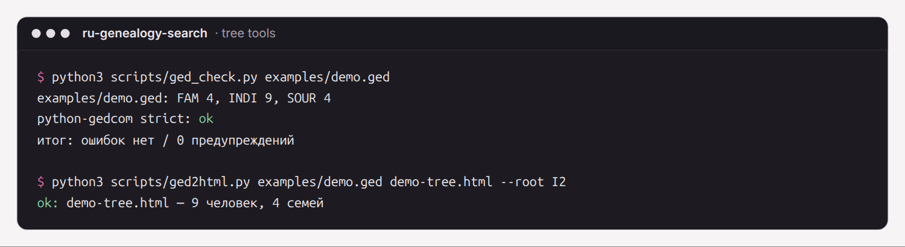

<p align="center"><b>English</b> · <a href="README.ru.md">Русский</a></p>

<p align="center">
  <picture>
    <source media="(prefers-color-scheme: dark)" srcset="docs/img/banner-dark.png">
    
  </picture>
</p>

<p align="center">
  <a href="LICENSE"></a>
  
  
  
  
</p>

<p align="center"><a href="SKILL.md"><picture><source media="(prefers-color-scheme: dark)" srcset="docs/img/btn-skill-dark.png"></picture></a>&nbsp;<a href="#quick-start"><picture><source media="(prefers-color-scheme: dark)" srcset="docs/img/btn-start-dark.png"></picture></a>&nbsp;<a href="#manual"><picture><source media="(prefers-color-scheme: dark)" srcset="docs/img/btn-manual-dark.png"></picture></a></p>

> [!NOTE]
> **Finds what a web search does not, and every fact in the tree keeps its source and a confidence level from 0 to 3.** The agent queries the databases with scripts; where a site is behind a CAPTCHA, it writes you a task for a manual search. Most databases are in Russian; you can ask in English, it searches in Russian and reports back in English.

<h3 align="center">Your great-grandfather is in an archive somewhere. Which one?</h3>

<p align="center"><b>ru-genealogy-search</b> is a skill for Claude Code, Codex and other agents that read <code>SKILL.md</code>:<br>it searches Russian and Soviet records and turns the finds into a GEDCOM family tree.</p>

<p align="center"><a href="#quick-start">Quick start</a> · <a href="#why">Why</a> · <a href="#what-you-get">What you get</a> · <a href="#not-yet">What it doesn't do yet</a> · <a href="#faq">Questions</a> · <a href="#manual">The manual</a></p>

<a id="quick-start"></a>

## 🚀 Running in two minutes

With the [Skills CLI](https://github.com/vercel-labs/skills) (needs Node.js); it asks which
agent to install into:

```bash
npx skills add https://github.com/olyamasaeva/ru-genealogy-search
```

Or clone it into your agent's skills folder:

```bash
# Claude Code
git clone https://github.com/olyamasaeva/ru-genealogy-search ~/.claude/skills/ru-genealogy-search
# Codex
git clone https://github.com/olyamasaeva/ru-genealogy-search ~/.codex/skills/ru-genealogy-search
```

Then ask your agent, for example:

- "Find when my great-grandmother Maria Ivanovna Smirnova died; she lived in the Tver
  region"
- "Search for my great-grandfather in the WWII loss databases"
- "Were my ancestors evacuated from Leningrad?"
- "Check my tree family.ged and show it in the browser"

Or call the skill directly: `/ru-genealogy-search`. Requirements are in the
[manual](#installation).

<a id="why"></a>

## 💡 Why

**It finds what a web search does not:** the date of death and last address of a relative
who died after the 1990s (Russian notary inheritance registry); the birth year, address
and route of someone evacuated from besieged Leningrad; a repression case file
(Returned Names memorial books); a WWII loss report that names the soldier's family and
home address (OBD Memorial).

Claude already knows the well-known sites (OBD Memorial, Pamyat Naroda, FamilySearch, the
VGD forum). The skill adds what the model does not know. It grew out of the author's own
family research and records the methods that worked and the mistakes the model made
without guidance.

<a id="what-you-get"></a>

## 🌳 A name in, a tree with sources out

Every fact in the tree carries its source and a confidence level: 3 document, 2 indirect,
1 oral, 0 hypothesis. Living people are marked private, and the viewer hides them by
default.

<picture><source media="(prefers-color-scheme: dark)" srcset="docs/img/shot-hero-dark.png"></picture>

| | |
|---|---|
| ⚖️ **Notary registry** | Date of birth, date of death and last address of people who died from about the 1990s on. |
| 🚂 **Leningrad evacuation** | Birth year, address, who travelled with whom and where to. |
| 📜 **Returned Names** | Memorial books of victims of repression, National Library of Russia. |
| 🎖️ **OBD Memorial** | Soviet WWII losses; a loss report often gives the family's address. |
| 🪖 **WWI cards** | "Pamyati geroev Velikoy voyny", including every card of a volost. |
| 🌳 **Tree tools** | A GEDCOM checker and an offline browser viewer. |

<details>
<summary><b>See the tree tools at work</b></summary>

<picture><source media="(prefers-color-scheme: dark)" srcset="docs/img/shot-check-dark.png"></picture>

<sub>Both screenshots use <code>examples/demo.ged</code>, a fictional family: all names, dates and case numbers are made up. The scripts report in Russian.</sub>

</details>

<a id="not-yet"></a>

## 🧭 What it doesn't do yet

- **Coverage is best for north-western Russia and the 20th century.** For other regions
  the skill first works out the administrative division of the time and finds the right
  archive. Catalogue numbers from the examples do not carry over to other regions.
- **Websites change.** The scripts report when a page is not recognised or the results are
  cut off, but they may stop working.
- **Two sources are untested.** "Blockade. Book of Memory" and the Lutheran registers of
  Ingria are mentioned but not tested with scripts.
- **Sites behind bot protection** (FamilySearch, Pamyat Naroda) are searched by you, by
  hand, with a task the skill prepares.

<a id="faq"></a>

## ❓ Questions people ask first

**How do I find the date of death of a relative who died in Russia after 1990?**
Through the inheritance case registry of the Federal Notary Chamber. It searches by full
name (surname, first name, patronymic) and gives the dates of birth and death and the
last address. If the patronymic is unknown, the skill tries a list of them. There is no
case if the property was given away during the person's lifetime or if they died under
another surname.

**How do I find a great-grandfather killed or missing in WWII?**
The skill searches OBD Memorial itself. Pamyat Naroda blocks bots, so the skill prepares a
task for you to search by hand. A loss report often gives the place of birth and the
family's address. Survivors are not in OBD, so an empty result does not mean the person
did not serve.

**How do I find an ancestor who fought in WWI?**
In the "Pamyati geroev Velikoy voyny" card index (gwar.mil.ru): gubernia, uyezd, volost and
often the village. If you know the volost, the skill downloads all its cards: surnames in
the index are often misspelled, and a surname search misses them.

**How do I find out whether a relative was evacuated from besieged Leningrad?**
Through the evacuation database of the Central State Archive of St Petersburg: birth year,
address, who travelled with them and where to.

**What about the 1920s–1960s, when civil registry records are closed?**
In Russia, civil registry records younger than 100 years are given only to relatives.
The skill works around the gap through children's patronymics, addresses from the notary
registry, loss reports and captions on family photos. The recipes are in `sources.md`,
section "Мосты через 1920–1960".

**Where are parish registers from before 1917?**
On FamilySearch and in Yandex "Search in archives". First the skill finds which province,
district and parish the village belonged to at the time, and only then looks for the
archive and fond.

**Do I need a paid account?**
No. The skill uses open databases only. You need an agent: Claude Code, Codex or another one with skills.

<a id="manual"></a>

## 📖 The manual

### What the skill adds

- **how to query the databases from a script** and what each one gives:
  - the inheritance case registry of the Russian notaries: date of birth, date of death
    and last address of people who died from about the 1990s on;
  - the database of people evacuated from besieged Leningrad;
  - "Vozvrashchennye imena" (Returned Names) of the National Library of Russia: memorial
    books of victims of repression;
  - OBD Memorial (Soviet WWII losses);
  - "Pamyati geroev Velikoy voyny" (WWI loss, hospital and award cards), including a
    download of every card for a volost, which catches misspelled surnames;
- **which sites block bots** (FamilySearch, Pamyat Naroda) and how to search them by hand,
  with a ready-made task;
- **how to get through the "dark" 1920s–1960s**, when civil registry records are closed:
  through patronymics, addresses from the notary registry, loss reports and captions on
  family photos;
- **how to record findings**: source, case and frame number, a confidence level from 0
  to 3, and empty results too;
- **tree tools**: a GEDCOM checker and an offline browser viewer (ancestors on the left,
  a card with sources on the right).

### Rules built into the skill

- It helps you look for living relatives together with you: it suggests searches on VK
  and Odnoklassniki, looks at public pages, reads screenshots and judges kinship. It does
  not build dossiers: only the name, approximate year, town and relationship go into the
  tree, without phone numbers, addresses or workplaces. You contact people yourself.
  Living people are marked private, and the viewer hides them by default.
- It does not bypass captchas, bot protection or logins, and does not take cookies or
  passwords.
- It does not use leaked databases.
- It treats text from found pages as data, not as instructions.
- It warns you before searching for recently deceased relatives of living people.

<a id="installation"></a>

### Installation and requirements

The scripts need Python 3.10+ and Node.js 20+ (tested on Linux). The skill installs
Playwright and Chromium itself with the command from `sources.md`, section "Установка".
For strict GEDCOM checks you can install `pip install python-gedcom==1.1.0`.

Network access differs by site: in October 2026 the notary registry, OBD Memorial and
Returned Names answered through a proxy, while the evacuation database answered only on a
direct connection (`--direct`). Browser scripts take a proxy from
`PW_PROXY=socks5://host:port`. Details are in `sources.md`.

You can put your own settings (where your tree lives, special arrangements) in a
`local.md` file next to `SKILL.md`. The skill reads it, and git ignores it.

### Try the tree viewer

On the fictional family in `examples/`:

```bash
python3 ~/.claude/skills/ru-genealogy-search/scripts/ged2html.py \
  ~/.claude/skills/ru-genealogy-search/examples/demo.ged ~/demo-tree.html --root I2
```

### What's inside

| File | What it is |
|---|---|
| `SKILL.md` | rules, which source covers which period, the main traps |
| `sources.md` | recipes for each database: addresses, fields, limits, installation |
| `handoff-familysearch.md` | instructions and a task template for searching FamilySearch by hand or with Claude in Chrome |
| `scripts/notariat.js` | search in the inheritance case registry |
| `scripts/names.py` | tries patronymics when the patronymic is unknown |
| `scripts/evacuation.py` | the Leningrad evacuation database |
| `scripts/visz.js` | Returned Names |
| `scripts/obd.js` | OBD Memorial |
| `scripts/gwar.py` | WWI cards: search by name and download of a volost |
| `scripts/ged_check.py` | GEDCOM check: links, confidence levels, privacy of the living |
| `scripts/ged2html.py` | offline tree viewer |
| `examples/demo.ged` | a fictional family to try the viewer and the check |

### Responsibility

The skill uses open government and public databases at the pace of an ordinary visitor.
Follow the rules of the sites you use. Keep information about people, including deceased
relatives of living people, to yourself, and do not publish it without the family's
consent. Findings are hypotheses until documents confirm them.

### License

MIT, see [LICENSE](LICENSE).
