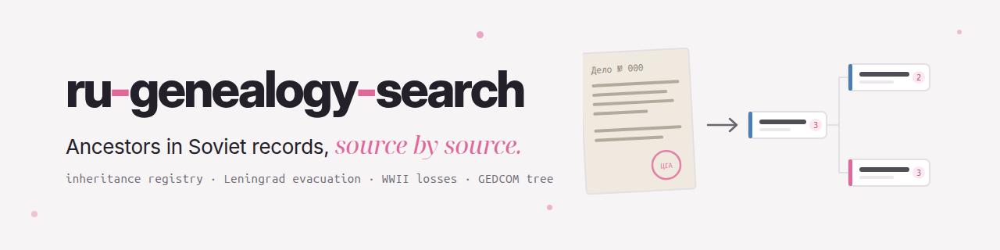
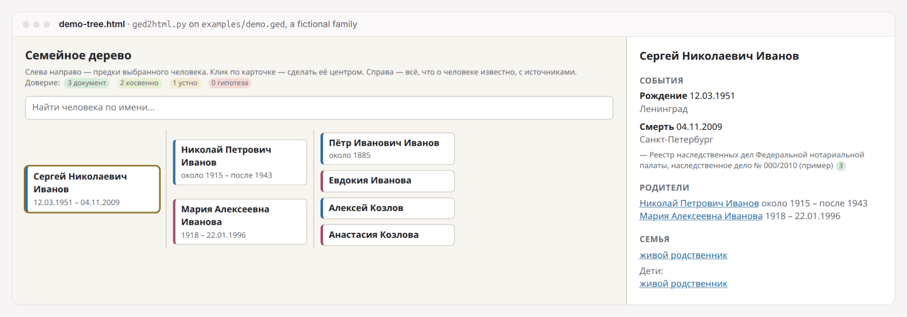
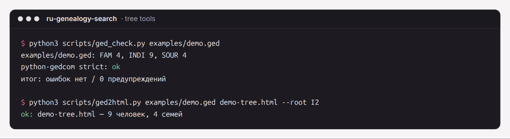

<p align="center"><a href="README.md">English</a> · <b>Русский</b></p>

<p align="center">
  <picture>
    <source media="(prefers-color-scheme: dark)" srcset="docs/img/banner-dark.png">
    
  </picture>
</p>

<p align="center">
  <a href="LICENSE"></a>
  
  
  
  
</p>

<p align="center"><a href="SKILL.md"><picture><source media="(prefers-color-scheme: dark)" srcset="docs/img/btn-skill-dark.png"></picture></a>&nbsp;<a href="#quick-start"><picture><source media="(prefers-color-scheme: dark)" srcset="docs/img/btn-start-dark.png"></picture></a>&nbsp;<a href="#manual"><picture><source media="(prefers-color-scheme: dark)" srcset="docs/img/btn-manual-dark.png"></picture></a></p>

> [!NOTE]
> **Находит то, чего нет в первой выдаче поисковика, и у каждого факта в дереве остаются источник и уровень доверия от 0 до 3.** Агент сам гоняет запросы по базам скриптами, а где сайт закрыт капчей, готовит вам задание на ручной поиск.

<h3 align="center">Прадед где-то в архиве. В каком?</h3>

<p align="center"><b>ru-genealogy-search</b> — скилл для ИИ-агентов: Claude Code, Codex и других, кто читает <code>SKILL.md</code>.<br>Ищет по русским и советским базам и собирает находки в родословное дерево GEDCOM.</p>

<p align="center"><a href="#quick-start">Быстрый старт</a> · <a href="#why">Зачем</a> · <a href="#what-you-get">Что получаешь</a> · <a href="#not-yet">Чего пока нет</a> · <a href="#faq">Вопросы</a> · <a href="#manual">Руководство</a></p>

<a id="quick-start"></a>

## 🚀 Запуск за две минуты

Одной командой через [Skills CLI](https://github.com/vercel-labs/skills)
(нужен Node.js), CLI спросит, в какого агента ставить:

```bash
npx skills add https://github.com/olyamasaeva/ru-genealogy-search
```

Или клоном в папку скиллов своего агента:

```bash
# Claude Code
git clone https://github.com/olyamasaeva/ru-genealogy-search ~/.claude/skills/ru-genealogy-search
# Codex
git clone https://github.com/olyamasaeva/ru-genealogy-search ~/.codex/skills/ru-genealogy-search
```

Потом напишите агенту, например:

- «Найди, когда умерла моя прабабушка Мария Ивановна Смирнова, жила в
  Тверской области»
- «Поищи моего прадеда в базах погибших и пропавших в войну»
- «Были ли мои предки в эвакуации из Ленинграда?»
- «Проверь моё дерево семья.ged и покажи его в браузере»

Или вызовите скилл явно: `/ru-genealogy-search`. Требования — в
[руководстве](#installation).

<a id="why"></a>

## 💡 Зачем

**Находит то, чего нет в первой выдаче поисковика:** дату смерти и последний
адрес родственника, умершего после 1990-х (реестр наследственных дел
нотариата); год рождения, адрес и маршрут блокадника (база эвакуированных из
Ленинграда); дело репрессированного (книги памяти «Возвращённые имена»);
донесение о гибели прадеда с адресом семьи (ОБД «Мемориал»).

Самые известные сайты (ОБД «Мемориал», «Память народа», FamilySearch, форум
ВГД) Claude знает и так. Скилл добавляет то, чего модель не знает.

Автор — Ольга Масаева. Скилл собран по опыту поиска собственной родословной:
сюда попали приёмы, которые реально сработали, и ошибки, на которых
спотыкалась модель без подсказки.

<a id="what-you-get"></a>

## 🌳 На входе имя, на выходе дерево с источниками

У каждого факта в дереве — источник и уровень доверия: 3 документ, 2 косвенно, 1 устно,
0 гипотеза. Живые помечаются как приватные, а просмотрщик по умолчанию их обезличивает.

<picture><source media="(prefers-color-scheme: dark)" srcset="docs/img/shot-hero-dark.png"></picture>

| | |
|---|---|
| ⚖️ **Реестр нотариата** | Дата рождения, дата смерти и последний адрес умерших примерно с 1990-х годов. |
| 🚂 **Эвакуация из Ленинграда** | Год рождения, адрес, с кем ехал и куда. |
| 📜 **«Возвращённые имена»** | Книги памяти жертв репрессий, РНБ. |
| 🎖️ **ОБД «Мемориал»** | Потери Великой Отечественной; донесение часто даёт адрес семьи. |
| 🪖 **Первая мировая** | «Памяти героев Великой войны», включая все карточки волости. |
| 🌳 **Инструменты для дерева** | Проверка GEDCOM и офлайн-просмотрщик в браузере. |

<details>
<summary><b>Инструменты для дерева в работе</b></summary>

<picture><source media="(prefers-color-scheme: dark)" srcset="docs/img/shot-check-dark.png"></picture>

<sub>Оба скриншота — на <code>examples/demo.ged</code>, вымышленной семье: все имена, даты и шифры дел придуманы.</sub>

</details>

<a id="not-yet"></a>

## 🧭 Чего пока нет

- **Лучше всего покрыты Северо-Запад России и XX век.** Для других регионов
  скилл сначала просит определить территорию по делению того времени и
  найти свой архив. Номера каталогов из примеров на другие регионы не
  переносятся.
- **Сайты меняются.** Скрипты сообщают, если страница не распознана или выдача
  обрезана, но могут перестать работать.
- **Два источника не проверены.** «Блокада. Книга памяти» и лютеранские метрики
  Ингерманландии упомянуты, но скриптами не проверены.
- **Сайты с защитой от ботов** (FamilySearch, «Память народа») ищете вы сами, руками,
  по заданию, которое готовит скилл.

<a id="faq"></a>

## ❓ Что спрашивают первым

**Как узнать дату смерти родственника, если он умер после 1990 года?**
Через реестр наследственных дел Федеральной нотариальной палаты. Он ищет по
полному ФИО и даёт дату рождения, дату смерти и последний адрес. Если
отчество неизвестно, скилл перебирает отчества списком. Дела нет, если
имущество подарили при жизни или человек умер под другой фамилией.

**Как найти прадеда, погибшего или пропавшего без вести в войну?**
ОБД «Мемориал» скилл ищет сам, «Память народа» закрыта защитой от ботов,
поэтому он готовит задание, по которому вы ищете руками. Донесение о потерях
часто даёт место рождения и адрес семьи. Живых и выживших в ОБД нет, поэтому
пустой результат не значит «не воевал».

**Как найти предка, воевавшего в Первую мировую?**
По «Памяти героев Великой войны»: там губерния, уезд, волость, часто
деревня. Если волость известна, скилл выгружает все её карточки: фамилии в
картотеке часто искажены, и поиск по фамилии их пропускает.

**Как узнать, был ли родственник в эвакуации из блокадного Ленинграда?**
По базе эвакуированных ЦГА СПб: год рождения, адрес, с кем ехал и куда.

**Что делать с 1920–1960-ми, если записи ЗАГС не выдают?**
Записи ЗАГС моложе 100 лет в России выдают только родственникам. Скилл
обходит этот провал через отчества детей, адреса из реестра нотариата,
донесения о потерях и подписи к семейным фото. Рецепты — в `sources.md`,
раздел «Мосты через 1920–1960».

**Где искать метрические книги до 1917 года?**
На FamilySearch и в Яндекс «Поиск по архивам». Сначала скилл определяет,
к какой губернии, уезду и приходу относилась деревня в то время, и только
потом ищет архив и фонд.

**Нужен ли платный доступ?**
Нет. Скилл работает только с открытыми базами. Нужен агент: Claude Code, Codex или другой со скиллами.

<a id="manual"></a>

## 📖 Руководство

### Чем он полезен

- **как обращаться к базам из скрипта** и что каждая из них может дать:
  - реестр наследственных дел нотариата — дата рождения, дата смерти и
    последний адрес умерших примерно с 1990-х годов;
  - база эвакуированных из блокадного Ленинграда;
  - «Возвращённые имена» РНБ — книги памяти жертв репрессий;
  - ОБД «Мемориал»;
  - «Памяти героев Великой войны»: карточки Первой мировой, включая выгрузку
    всех карточек волости, где находятся искажённые фамилии;
- **где защита от ботов** (FamilySearch, «Память народа») и как искать там
  руками, с готовым заданием;
- **как пройти «тёмные» 1920–1960-е**, когда записи ЗАГС закрыты: через
  отчества, адреса из реестра, донесения о потерях, подписи к семейным фото;
- **как записывать находки**: источник, номер дела и кадра, уровень доверия
  от 0 до 3, пустые результаты тоже;
- **инструменты для дерева**: проверка файла GEDCOM и офлайн-просмотрщик в
  браузере (предки слева, карточка с источниками справа).

### Правила, встроенные в скилл

- Живую родню скилл помогает искать вместе с вами: подсказывает запросы для
  ВК и Одноклассников, смотрит открытые страницы, разбирает скриншоты и
  оценивает родство. Досье он не собирает: в дерево попадают только имя,
  примерный год, город и родство, без телефонов, адресов и работы. Писать
  найденным людям будете вы сами. Живые в дереве помечаются как приватные,
  а просмотрщик по умолчанию их обезличивает.
- Капчу, защиту от ботов и вход под чужим аккаунтом он не обходит, куки и
  пароли не берёт.
- Утёкшие базы и «пробивы» не использует.
- Тексты найденных страниц считает данными, а не командами.
- Перед поиском по недавно умершим родственникам живых людей предупреждает
  вас.

<a id="installation"></a>

### Установка и требования

Для скриптов нужны Python 3.10+ и Node.js 20+ (проверено на Linux). Скилл сам
поставит playwright и Chromium по команде из `sources.md`, раздел
«Установка». Для строгой проверки GEDCOM можно поставить
`pip install python-gedcom==1.1.0`.

Доступ к сайтам разный: в октябре 2026 года реестр нотариата, ОБД «Мемориал» и
«Возвращённые имена» отвечали через прокси, а база эвакуированных — только при прямом
подключении (`--direct`). Браузерные скрипты берут прокси из
`PW_PROXY=socks5://host:port`. Подробности — в `sources.md`.

Свои настройки (где лежит ваше дерево, особые договорённости) можно положить
в файл `local.md` рядом со `SKILL.md`. Скилл прочитает его, а в git этот
файл не попадёт.

### Попробовать просмотрщик

На вымышленной семье из `examples/`:

```bash
python3 ~/.claude/skills/ru-genealogy-search/scripts/ged2html.py \
  ~/.claude/skills/ru-genealogy-search/examples/demo.ged ~/demo-tree.html --root I2
```

### Что внутри

| Файл | Что это |
|---|---|
| `SKILL.md` | правила, какой источник за какую эпоху отвечает, главные ловушки |
| `sources.md` | рецепты по каждой базе: адреса, поля, ограничения, установка |
| `handoff-familysearch.md` | инструкция и шаблон задания для поиска на FamilySearch руками или с помощью Claude в Chrome |
| `scripts/notariat.js` | поиск в реестре наследственных дел |
| `scripts/names.py` | перебор отчеств, когда отчество неизвестно |
| `scripts/evacuation.py` | база эвакуированных из Ленинграда |
| `scripts/visz.js` | «Возвращённые имена» |
| `scripts/obd.js` | ОБД «Мемориал» |
| `scripts/gwar.py` | карточки Первой мировой: поиск по ФИО и выгрузка волости |
| `scripts/ged_check.py` | проверка файла GEDCOM: связи, уровни доверия, приватность живых |
| `scripts/ged2html.py` | офлайн-просмотрщик дерева |
| `examples/demo.ged` | вымышленная семья для пробы просмотрщика и проверки |

### Ответственность

Скилл обращается к открытым государственным и общественным базам в темпе
обычного посетителя. Соблюдайте правила сайтов, которыми пользуетесь.
Сведения о людях, в том числе об умерших родственниках живых, храните у себя
и не публикуйте без согласия семьи. Находки — это гипотезы, пока их не
подтвердят документы.

### Лицензия

MIT — см. [LICENSE](LICENSE).
